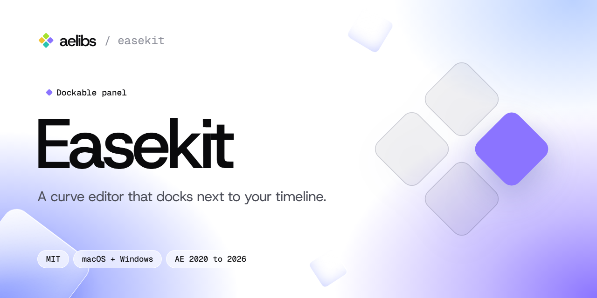

<picture>
  <source media="(prefers-color-scheme: dark)" srcset=".github/banner-dark.png">
  
</picture>

A curve editor that docks next to your timeline in After Effects. Shape an ease, save it to your library, and apply it to the selected keyframes on any property: opacity, scale, rotation, position, color, mask and shape paths.

Free and open source (MIT), part of [aelibs](https://aelibs.com).

- **Works with** After Effects 2020 to 2026
- **Runs on** macOS and Windows

## Install

1. Download `easekit.zxp` from the [latest release](https://github.com/aelibraries/easekit/releases/latest).
2. Install it with any ZXP installer. Without one, rename it to `easekit.zip` and extract it into a new folder named `com.aelibs.easekit` here:
   - macOS: `~/Library/Application Support/Adobe/CEP/extensions/`
   - Windows: `%APPDATA%\Adobe\CEP\extensions\`
3. Restart After Effects and open **Window → Extensions → Easekit**.

You only do this once. When a new version is out, an **Update** button appears in the panel's header and installs it in place, keeping your settings and library.

## Using it

**Shape a curve.** Drag the two handles in the graph. The readout below it shows the curve as `cubic-bezier(x1, y1, x2, y2)`. You can also type or paste values there: `cubic-bezier(.16, 1, .3, 1)`, `0.16 1 0.3 1` and `[.16, 1, .3, 1]` all work. The strip under the readout plays the motion while you're over the panel. Its dots are equal steps in time, and the two ticks mark the start and end of the move, so overshoot shows as travel past the end.

**Apply it.** Select keyframes in the timeline, choose a side at the bottom and press **Apply** (or Enter). When you move the pointer over the panel, the button shows how many keyframes are selected. The panel only checks while it's hovered, so it never interrupts a preview.

| Side | What changes |
| --- | --- |
| Both | The whole curve, on both sides of each segment |
| Out | Only the outgoing side of each keyframe (the first handle) |
| In | Only the incoming side of each keyframe (the second handle) |

Which segments are eased:

- Between two selected neighbouring keyframes, the segment gets the whole curve.
- A selected keyframe with no selected neighbour gets the curve on both of its sides.
- Keyframes you didn't select, and sides you didn't ask for, are left exactly as they were, including auto-bezier and continuous keyframes.
- Hold keyframes become bezier, since applying an ease means you want motion there.
- Everything you apply is one step in **Edit → Undo**.

**Read a curve back.** The eyedropper in the graph's corner reads the ease of the selected keyframes into the editor, so you can tweak it or save it.

**Library.** It starts with 16 curves. Click one to load it, double-click to apply it, or hover and press **Apply**. Right-click a curve to apply one side only, rename, duplicate, replace it with the current curve, copy it or delete it (deleting can be undone from the message that appears). Drag curves to reorder them. **+** saves the current curve. The **…** menu imports and exports the library as JSON, sorts it, restores the built-in curves or clears it. A filter field appears once you have ten or more curves.

The graph's other two corner buttons mirror the curve (an ease-out becomes the matching ease-in) and reset it to linear.

### How the curve maps to After Effects

Easekit uses the same mapping as After Effects' graph editor. For a segment from keyframe A to keyframe B with average speed S:

- A's outgoing ease: influence `x1 × 100`, speed `(y1 / x1) × S`
- B's incoming ease: influence `(1 − x2) × 100`, speed `((1 − y2) / (1 − x2)) × S`

S comes from After Effects itself, so the result is exact for every property type, including path length on position and the distance between colors. Two limits are After Effects' own: influence is kept between 0.1% and 100%, and motion paths (position, anchor point) can't go below zero speed. Curves that dip below 0 at the start are flattened on those properties, and Easekit tells you when that happens.

### Keyboard and mouse

| | |
| --- | --- |
| Enter | Apply |
| Ctrl/Cmd + C | Copy the curve as `cubic-bezier(…)` |
| Ctrl/Cmd + Z, Ctrl/Cmd + Shift + Z | Undo and redo in After Effects, even while the panel has focus |
| Shift while dragging | Snap to .05 (or turn snapping off, if it's on in Settings) |
| Double-click a handle | Reset that handle |
| Delete | Delete the selected library curve |
| Escape | Close menus and settings |

## Settings

The gear icon opens them.

- **Easekit:** handle snapping, 2 or 3 decimals, default side, allow overshoot, animate the preview, show values in the library, double-click to apply.
- **Appearance:** follow After Effects' interface color, or use a fixed dark or light theme. Pick an accent color and a compact or comfortable density.
- **Updates:** check when the panel opens (at most a few times a day), include pre-releases, or check now. Updates come from this repository's GitHub releases.

## Building from source

The interface, updater and ExtendScript helpers in `shared/` are the same ones the other aelibs panels use.

```sh
node build.mjs easekit            # dist/easekit/ and dist/easekit.zip
node build.mjs easekit --install  # also installs it for your user, for testing
node test/run.mjs easekit         # runs the host tests inside After Effects
```

An unsigned build only loads with CEP debug mode on. On Windows, set `PlayerDebugMode` to `1` under `HKEY_CURRENT_USER\Software\Adobe\CSXS.11` (and `.12`). On macOS, run `defaults write com.adobe.CSXS.11 PlayerDebugMode 1`.

The tests open a fresh, unsaved project and discard it afterwards, so close your own work first. Keep the pointer off the Easekit panel while they run: the panel talks to After Effects while it's hovered, and After Effects refuses command-line scripts that arrive during that.

### Releasing

1. Bump `version` in `plugin.json`.
2. Put Adobe's [ZXPSignCmd](https://github.com/Adobe-CEP/CEP-Resources/tree/master/ZXPSignCMD) in `tools/` (or set `ZXPSIGNCMD`) and run `node build.mjs easekit`. You get a signed `dist/easekit.zxp`.
3. Publish a GitHub release tagged `v1.2.3` with `easekit.zxp` attached under exactly that name. Installed panels find it through the GitHub API and offer the update.

## License

MIT. Host Grotesk and Geist Mono are bundled under the SIL Open Font License. Not affiliated with Adobe. After Effects is a trademark of Adobe Inc.
